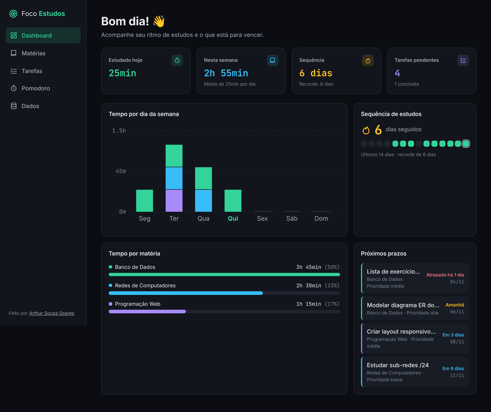
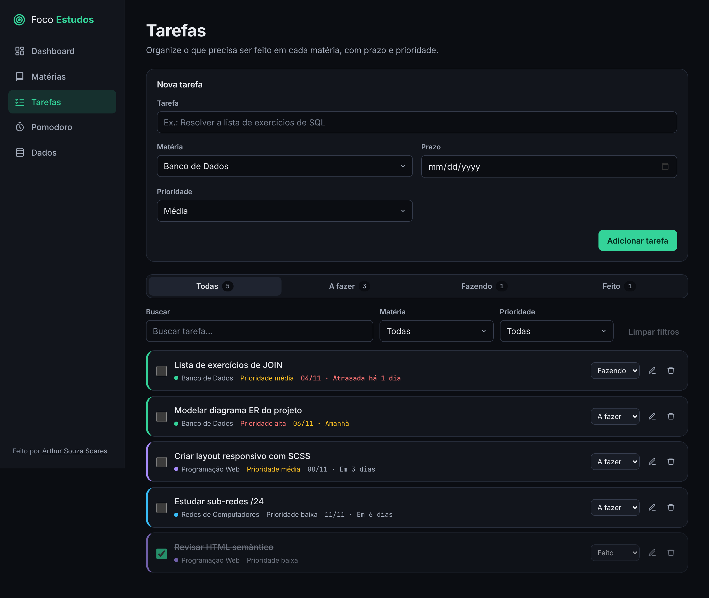
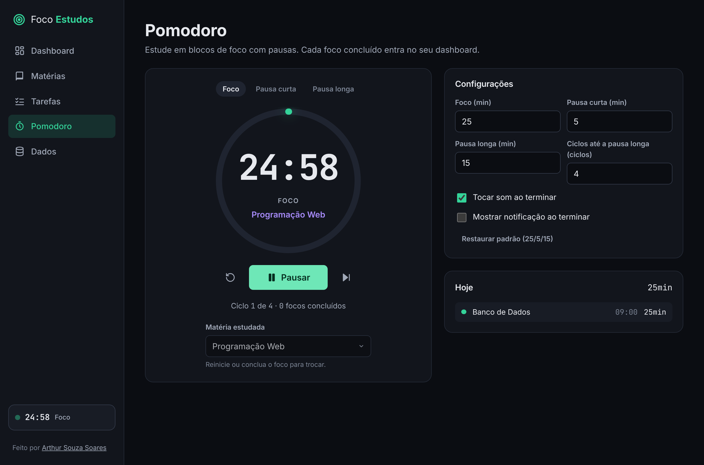
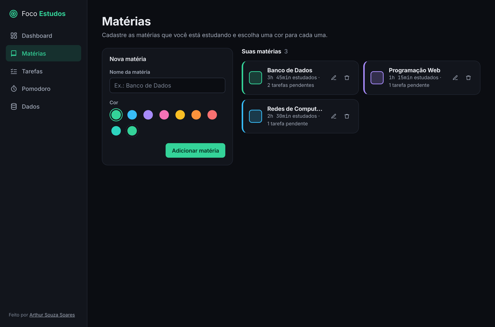
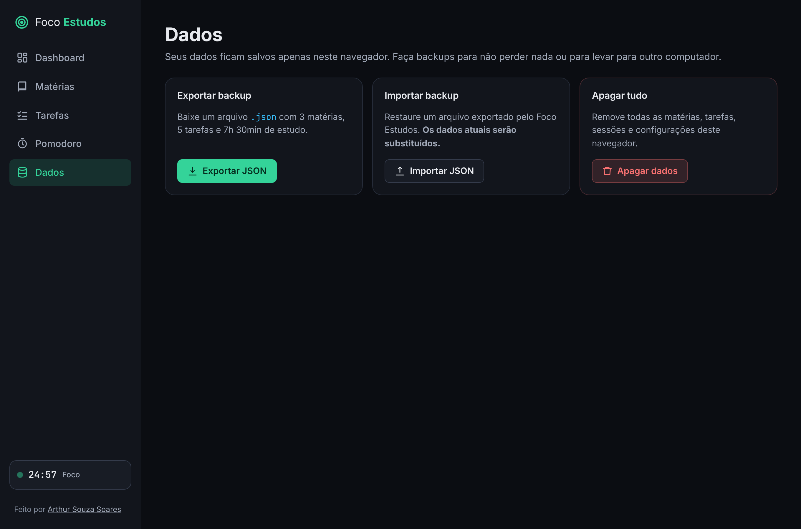
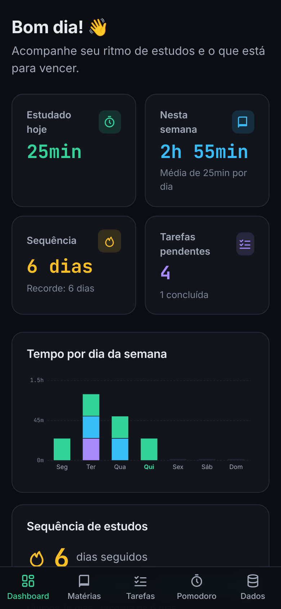

<h1 align="center">🎯 Foco Estudos</h1>

<p align="center">
  App web para estudantes organizarem os estudos: matérias, tarefas com prazo, timer Pomodoro e um dashboard com o seu progresso.
  <br />
  <strong>Tudo salvo no seu navegador — sem cadastro, sem servidor.</strong>
</p>

<p align="center">
  <a href="https://arthursouzas.github.io/foco-estudos"><strong>🌐 Acessar o site</strong></a>
</p>

<p align="center">
  
  
  
  
  
</p>

---

## 📖 Sobre o projeto

O **Foco Estudos** nasceu de uma necessidade real do dia a dia de quem estuda: saber **o que precisa ser feito**, **quanto tempo está sendo dedicado a cada matéria** e **manter a constância**.

Projeto desenvolvido por **Arthur Souza Soares**, estudante de Desenvolvimento de Sistemas no **SENAI**, como parte do meu portfólio. O foco foi construir uma aplicação completa no front-end, com código organizado, tipagem forte, testes automatizados, acessibilidade e deploy contínuo.

## 🖼️ Prints

| Dashboard | Tarefas |
| :---: | :---: |
|  |  |

| Pomodoro | Matérias |
| :---: | :---: |
|  |  |

| Dados (backup) | Celular |
| :---: | :---: |
|  |  |

## ✨ Funcionalidades

- **📚 Matérias** — criar, editar e excluir matérias com nome e cor (paleta pronta ou cor personalizada). Nomes duplicados são bloqueados.
- **📝 Tarefas** — tarefas por matéria com **prazo**, **prioridade** (alta, média, baixa) e **status** (a fazer, fazendo, feito).
  - Filtros por status, matéria, prioridade e busca por texto (ignora acentos).
  - Ordenação inteligente: prazos mais próximos e prioridade alta primeiro; concluídas no fim.
  - Destaque para tarefas atrasadas ou vencendo em breve.
- **⏱️ Timer Pomodoro** — 25/5 min por padrão, com pausa longa a cada N ciclos, tudo configurável.
  - Ligado a uma matéria: cada foco concluído vira uma sessão de estudo.
  - **Som** ao terminar (gerado com a Web Audio API, sem arquivos) e **notificação** do navegador.
  - Continua rodando ao trocar de página e até após recarregar (baseado no horário de término, não em contagem de ticks).
  - Tempo restante no título da aba e mini-timer na navegação.
- **📊 Dashboard**
  - Tempo estudado **por dia da semana** (barras empilhadas por matéria, em SVG puro).
  - Tempo estudado **por matéria** (barras em CSS).
  - **Sequência de dias estudados** (atual e recorde) com calendário dos últimos 14 dias.
  - **Tarefas próximas do prazo** (atrasadas e dos próximos 7 dias).
- **💾 Exportar e importar JSON** — backup completo dos dados, com validação do arquivo antes de importar.
- **♿ Acessível e responsivo** — navegação por teclado, link "pular para o conteúdo", rótulos e `aria-*`, anúncios para leitores de tela, respeito ao `prefers-reduced-motion` e layout pensado para celular (barra de navegação inferior).

## 🛠️ Tecnologias

| Tecnologia | Uso |
| --- | --- |
| [Next.js 16](https://nextjs.org/) (App Router) | Estrutura do app e **export estático** (`output: "export"`) |
| [React 19](https://react.dev/) | Interface e hooks customizados |
| [TypeScript](https://www.typescriptlang.org/) | Tipagem estrita (`strict` + `noUncheckedIndexedAccess`) |
| [SCSS Modules](https://sass-lang.com/) | Estilos isolados por componente, tema escuro com variáveis CSS |
| `localStorage` | Persistência dos dados, sem back-end |
| [Vitest](https://vitest.dev/) + [Testing Library](https://testing-library.com/) | Testes de lógica, hooks e componentes |
| ESLint | Padrões de código do Next.js |
| GitHub Actions + GitHub Pages | Testes e deploy automáticos a cada push na `main` |

Fontes: **Inter** e **JetBrains Mono**. Paleta: fundo `#0b0d12`, verde `#34d399`, azul `#38bdf8` e roxo `#a78bfa`.

## 🗂️ Estrutura

```
src/
├── app/                # Rotas (App Router): /, /materias, /tarefas, /pomodoro, /dados
├── components/
│   ├── ui/             # Botão, Card, Modal, campos de formulário...
│   ├── layout/         # Navegação lateral / inferior
│   ├── dashboard/      # Gráficos em SVG/CSS, cards e prazos
│   ├── subjects/       # CRUD de matérias
│   ├── tasks/          # CRUD e filtros de tarefas
│   ├── pomodoro/       # Timer e configurações
│   └── data/           # Exportar / importar / apagar
├── context/            # Providers de dados e do Pomodoro
├── hooks/              # useLocalStorage e usePomodoro
├── lib/                # Lógica pura e testada: reducer (CRUD), timer, estatísticas, validação
└── styles/             # Tema global e mixins SCSS
```

A regra de negócio fica em funções puras dentro de `src/lib` (reducer de CRUD, máquina de estados do timer, cálculos do dashboard e validação do backup). Isso deixa os componentes simples e a lógica fácil de testar.

## 🚀 Como rodar

Pré-requisitos: **Node.js 20+** e **npm**.

```bash
# 1. Clonar o repositório
git clone https://github.com/arthursouzas/foco-estudos.git
cd foco-estudos

# 2. Instalar as dependências
npm install

# 3. Rodar em modo de desenvolvimento
npm run dev
```

Acesse **http://localhost:3000/foco-estudos**.

### Scripts

| Comando | O que faz |
| --- | --- |
| `npm run dev` | Servidor de desenvolvimento |
| `npm run build` | Gera o site estático na pasta `out/` |
| `npm test` | Roda os testes uma vez |
| `npm run test:watch` | Testes em modo observação |
| `npm run lint` | ESLint |
| `npm run typecheck` | Checagem de tipos do TypeScript |

> O site é publicado em `/foco-estudos`. Para rodar na raiz de um domínio, use `NEXT_PUBLIC_BASE_PATH="" npm run build`.

## 🧪 Testes

Os testes cobrem a lógica principal:

- **Timer Pomodoro** — contagem, pausa/continuação, troca de fases, pausa longa, pular fase e retomada após recarregar.
- **Dashboard** — tempo por matéria, por dia da semana, sequência de dias (incluindo virada de mês) e tarefas próximas do prazo.
- **CRUD** — reducer de matérias, tarefas e sessões, além de testes de interface criando, editando, filtrando e excluindo.
- **useLocalStorage** — leitura, gravação, dados corrompidos e sincronização entre abas.
- **Backup** — exportação/importação e validação de arquivos inválidos.

```bash
npm test
```

## ☁️ Deploy

O workflow [`.github/workflows/deploy.yml`](.github/workflows/deploy.yml) roda lint, checagem de tipos e testes, gera o export estático e publica no **GitHub Pages** a cada push na `main`.

Para ativar: em **Settings → Pages → Build and deployment**, selecione **Source: GitHub Actions**.

## 👤 Autor

**Arthur Souza Soares** — estudante de Desenvolvimento de Sistemas no SENAI.

[](https://github.com/arthursouzas)

## 📄 Licença

Distribuído sob a licença MIT. Veja [LICENSE](LICENSE).
